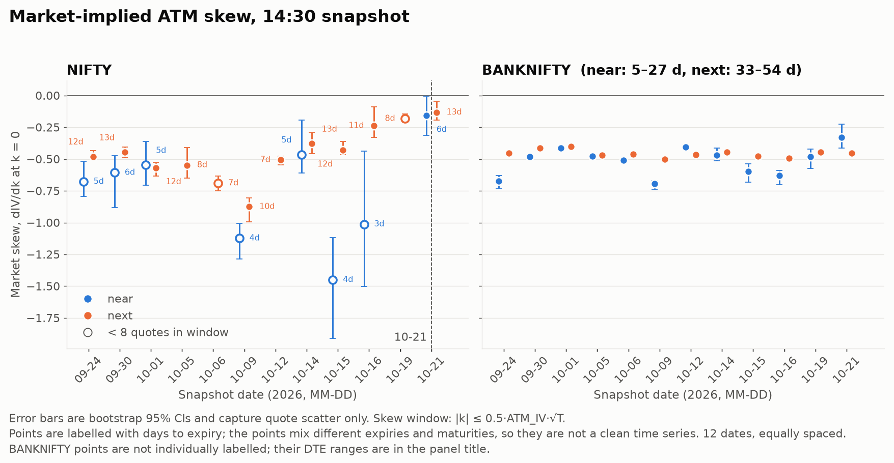

# optquant: NSE index-option vol surfaces

Research project on NIFTY and BANKNIFTY options: collect live chains from the
DhanHQ API, clean them, fit raw SVI per expiry, calibrate Heston per expiry, price
a barrier with QE Monte Carlo, and check what the market skew says. Full write-up:
**[docs/WRITEUP.md](docs/WRITEUP.md)**. The aggregate result CSVs and two figures it
cites are in [docs/results/](docs/results/).



*Market-implied ATM skew per date, 14:30 snapshot. Negative on all 44 slices. NIFTY points are labelled with days to expiry; points mix expiries and maturities, and error bars capture quote scatter only.*

## Results (12 fitted dates, 2026-09-24 to 2026-10-21; details and sources in the write-up)

- Market-implied ATM skew was negative on all 44 slices.
- BANKNIFTY's far expiry held a skew of about −0.40 to −0.50 (DTE 33–54).
- Among the six NIFTY "next" slices at 12–13 DTE, skew on 10-21 was much flatter than on
  the other five, cause unknown (the claim rests on that one date); single-snapshot skew
  varies by about 0.1 within a day.
- The `a ≥ 0` raw-SVI fit's rho and ATM IV are unreliable on these slices, so skew is measured
  model-free. The Heston calibration is per-expiry and at least 26 of 44 fits hit a bound (33 at a 1% tolerance).

No claim of rho stability, a regime change, a drift or predictive power is made.

## Data

`data/` is **not included** (it is git-ignored and holds your own collected chains), and
`results/` is regenerated. A fresh clone can run the tests but not the analysis.

## Run

```
pip install -r requirements.txt -r requirements-dev.txt
python -m pytest                      # synthetic data, runs anywhere
python -m pytest --collect-only -q    # 101 tests collected
```

With your own chains in `data/`, run from the repo root in the order given in
[analysis/README.md](analysis/README.md): `analysis/date_audit.py`, `daily_fits.py`,
`svi_refit.py`, `skew_check.py`, then `analysis/skew_*.py`. `analysis/mc_validation.py`
checks the Monte Carlo against the semi-analytic pricer. The collector is
`collector.py` (needs `DHAN_ACCESS_TOKEN` and `DHAN_CLIENT_ID`; never commit `.env`).
